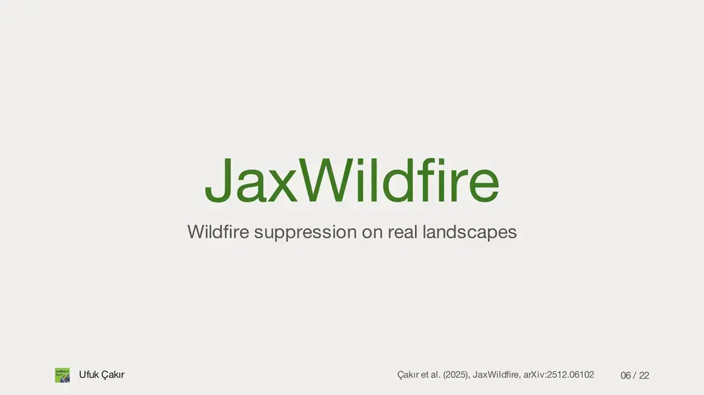
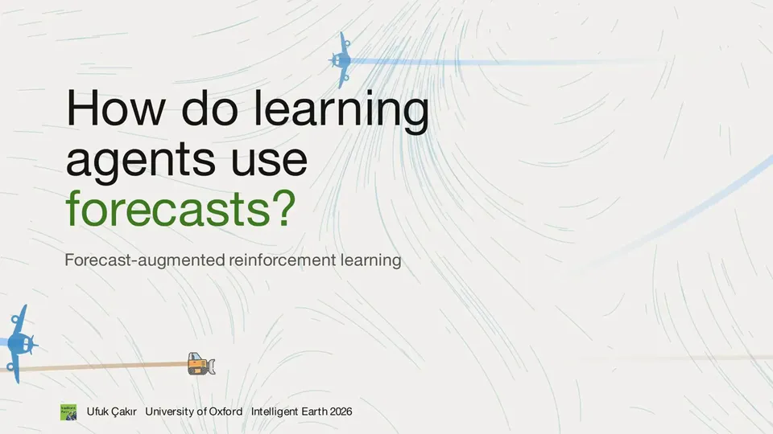
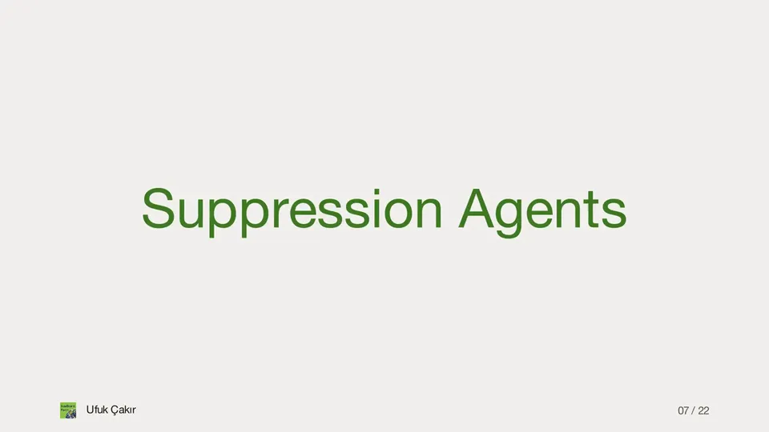
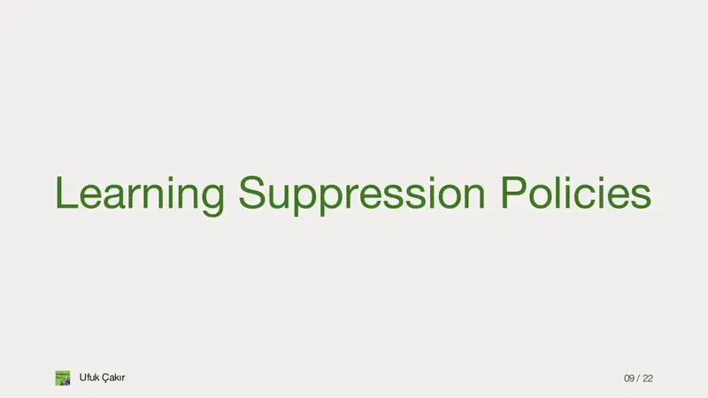
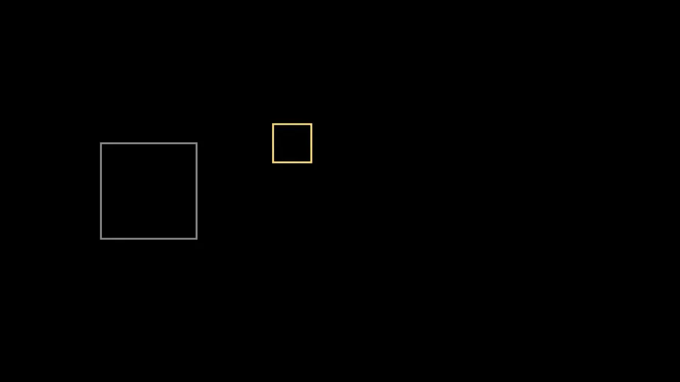
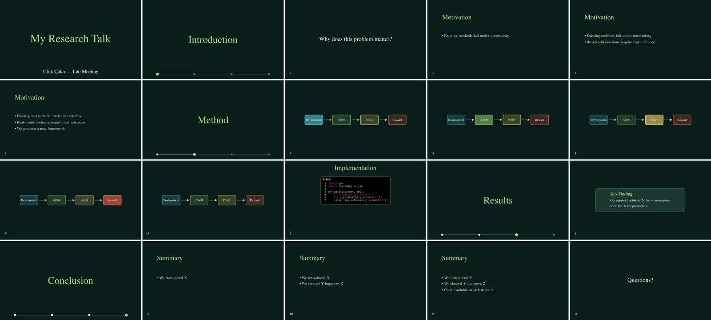

# manim-deck: animated research talks in Python

**Ufuk Çakır**

Templates and animation modules for research presentations with
[Manim](https://github.com/ManimCommunity/manim) and [Manim Slides](https://github.com/jeertmans/manim-slides).

<p align="center">
  
</p>
<p align="center"><sub>
  How <a href="https://arxiv.org/abs/2512.06102">JaxWildfire</a> builds a landscape, one click at a time
  (from my talk at the Intelligent Earth conference 2026).
</sub></p>

> This repo gives you a reusable Python package (`manim_deck`) with
> pre-built slide templates and animation modules. You can fork, customise, and use it to
> build your next cool conference talk!

<table>
  <tr>
    <td width="33%" valign="top">
      <b><a href="#using-the-manim_deck-template">Slide templates</a></b><br>
      Eight slide types, themes and a progress bar in one base class, <code>TemplateSlide</code>.
    </td>
    <td width="33%" valign="top">
      <b><a href="#writing-reusable-animation-modules">Animation modules</a></b><br>
      Reusable animations you drop into any talk: pipelines, callouts, networks, a wildfire explainer.
    </td>
    <td width="33%" valign="top">
      <b><a href="#working-with-coding-agents">Agent-friendly</a></b><br>
      An <code>AGENTS.md</code> for coding agents, and a preview tool that turns a talk into one still per slide.
    </td>
  </tr>
</table>

**Contents:**
[How it works](#how-it-works) ·
[What you can make](#what-you-can-make) ·
[Quick start](#quick-start) ·
[Manim crash course](#core-manim-concepts-just-a-crash-course) ·
[Manim Slides](#from-manim-to-manim-slides) ·
[The template](#using-the-manim_deck-template) ·
[Animation modules](#writing-reusable-animation-modules) ·
[Coding agents](#working-with-coding-agents) ·
[Tips](#tips--workflow)

---

## How it works

<p align="center">
  
</p>

1. **[Manim](https://github.com/ManimCommunity/manim)** draws your animations from Python code. Your talk is a `.py` file.
2. **[Manim Slides](https://github.com/jeertmans/manim-slides)** renders that file and cuts it at every `self.next_slide()`, so each slide becomes one short video.
3. **The export** turns those videos into an HTML page that runs on [Reveal.js](https://revealjs.com/) and plays in any browser, or into a PDF or a PowerPoint file. You can also present live with `manim-slides present`.

manim-deck sits on top of step 1: slide templates, themes and reusable animation modules, so writing a talk is mostly writing its content.

---

## What you can make

Some slides from my own talks. Both talks subclass `TemplateSlide` with their own style:

<table>
  <tr>
    <td width="50%"></td>
    <td width="50%"></td>
  </tr>
  <tr>
    <td><sub><b>Title slide.</b> Streamlines of a wind field, with two airtankers and a bulldozer crossing it in a loop.</sub></td>
    <td><sub><b>Suppression agents.</b> Episodes of the real simulator with scripted agents, saved to <code>.npz</code> and replayed cell by cell.</sub></td>
  </tr>
  <tr>
    <td></td>
    <td></td>
  </tr>
  <tr>
    <td><sub><b>Training in parallel.</b> 512 environments stepped together with JAX, the learning curve, and one trained policy next to no intervention (one evaluation episode, picked for display).</sub></td>
    <td><sub><b>Maths.</b> Binary entropy traced point by point, from a reading-group talk on Abel et al. (2025).</sub></td>
  </tr>
</table>

**How these were made**, in case you want to build something similar:

- Every map is a NumPy array shown as an `ImageMobject`. The simulations run
  beforehand in a separate script and are saved to `.npz`, so the slide code only draws.
- The 3D terrain is rendered off-screen (with `moderngl`) into a full-frame image, and
  Manim cross-fades it with the flat map.
- The looping clips (wind, fire replays, the title) use `self.next_slide(loop=True)`:
  the animation repeats until you click.

The code for these talks is not public, but everything below shows the patterns they use.

---

## Quick start

```bash
# 1. Clone (or fork) this repo
git clone https://github.com/ufuk-cakir/manim-deck.git
cd manim-deck

# 2. Install with uv (creates a venv with Python 3.11)
uv sync

# 3. Render the example talk (-ql = low quality, fast)
uv run manim-slides render -ql talks/example-talk/main.py ExampleTalk

# 4. Present it
uv run manim-slides ExampleTalk
```

Have Fun!

You need [uv](https://docs.astral.sh/uv/), a LaTeX installation for `MathTex`
equations, and [ffmpeg](https://ffmpeg.org/) plus libwebp (`brew install webp`) for the preview and clip scripts.

> **⚠️ Note:** This template has not been extensively tested across all platforms and configurations.
> If you encounter any issues or have questions, please feel free to [submit an issue on GitHub](https://github.com/ufuk-cakir/manim-deck/issues) or reach out directly. Contributions and feedback are very welcome!

---

## Project structure

```
manim-deck/
│
├── pyproject.toml              # Package definition (uv / pip)
├── README.md
├── AGENTS.md                   # Instructions for coding agents (Codex, Claude Code, ...)
├── CLAUDE.md                   # Points Claude Code to AGENTS.md
├── manim_deck.toml             # Your default author name and email
│
├── src/
│   └── manim_deck/             # The importable package
│       ├── templates/
│       │   ├── base.py         # TemplateSlide is the core class
│       │   └── theme.py        # Theme dataclass + built-in themes
│       └── animations/         # Reusable animation modules
│           ├── pipeline.py     # Animated pipeline diagram
│           ├── callout.py      # Highlight / callout box
│           ├── neural_net.py   # Feedforward network with a forward pass
│           └── custom/         # Modules from my wildfire talks (for inspiration)
│
├── talks/                      # One folder per talk (scripts, not importable)
│   ├── example-talk/main.py
│   └── manim-research-talks-tutorial/   # My Manim tutorial talk, with its HTML export
│
├── tools/preview.py            # Render a talk and save one still per slide
└── docs/                       # Scenes and animations for this README
```

**Key idea:** The `manim_deck` package holds everything reusable (templates,
themes, animation modules). Each talk in `talks/` is a standalone script that
imports from the package. When you build a cool new animation for one talk,
move it into `manim_deck/animations/` and it's available everywhere.

---

## Why Manim for research presentations?

If you ever watched a [3Blue1Brown](https://www.3blue1brown.com/) video, you have seen
what Manim can do!

<table>
  <tr>
    <th width="50%">Why I think you should use it for academic presentations</th>
    <th width="50%">The tradeoffs</th>
  </tr>
  <tr>
    <td valign="top">

- Animated visuals are way more engaging than static bullet points.
- Step-by-step animations let you build up complex ideas incrementally.
- Building the animation forces you to translate your research into an animation sequence that distils the core message.
- Everything is version-controlled since your slides are `.py` files, which makes it easy to track changes or revert to old versions.
- **PROGRAMMATIC.** Everything is Python, which means you can use for loops, functions and classes to build complex animations. You need to draw 50 boxes? That's way easier with a loop than copy-pasting in PowerPoint. You want to reuse the same architecture diagram across multiple talks, but with different labels? A reusable animation module is perfect for that!!!
- You can plot your **real data**: load your results with NumPy and animate them directly.

</td>
    <td valign="top">

- Steeper learning curve than drag-and-drop tools.
- It can be a rabbit hole.
- Iteration is slower (render, check, tweak, re-render).
- Not great for last-minute slide reshuffling 5 minutes before your talk.

</td>
  </tr>
</table>

---

## Core Manim concepts (just a crash course)

This is by no means a comprehensive Manim tutorial! There are so many great resources out there to dive deeper, but this is just to get you started and familiar with the core concepts.

Every animation here is rendered from the full script next to it (the same scenes are in
[`docs/readme_clips.py`](docs/readme_clips.py)). Save one as `scene.py` and run
`uv run manim render -ql scene.py Mobjects` to try it.

<table>
  <tr>
    <td width="50%" valign="top">

### 1. Mobjects

Everything on screen is a Mobject (Mathematical Object). Text, shapes, arrows and equations are Python objects with properties and methods.

```python
from manim import *


class Mobjects(Scene):
    def construct(self):
        circle = Circle(radius=1, color=BLUE)
        label = Text("Hello", font_size=36)
        eq = MathTex(r"E = mc^2")
        arrow = Arrow(LEFT, RIGHT)

        row = VGroup(circle, label, eq, arrow)
        row.arrange(RIGHT, buff=1)
        for mob in row:
            self.play(FadeIn(mob, shift=UP))
        self.wait()
```

</td>
    <td valign="middle" align="center" width="50%"></td>
  </tr>
  <tr>
    <td valign="top">

### 2. Animations

Animations transform Mobjects over time. You trigger them with `self.play()`.

```python
from manim import *


class Animations(Scene):
    def construct(self):
        circle = Circle(color=BLUE, fill_opacity=0.3)
        circle.shift(LEFT * 1.5)
        square = Square(side_length=2, color=GREEN)
        square.set_fill(GREEN, opacity=0.3)
        square.shift(RIGHT * 1.5)

        self.play(Create(circle))
        self.play(circle.animate.shift(RIGHT * 3))
        self.play(Transform(circle, square))
        self.play(FadeOut(circle))
        self.wait()
```

Others: `FadeIn`, `Write`, `GrowArrow`, `Rotate`, `LaggedStart`, `AnimationGroup`.

</td>
    <td valign="middle" align="center"></td>
  </tr>
  <tr>
    <td valign="top">

### 3. Positioning

Place things absolutely, against the frame, or relative to each other. `.animate` turns each move into an animation.

```python
from manim import *


class Positioning(Scene):
    def construct(self):
        other = Square(color=GRAY).shift(LEFT * 4)
        mob = Square(side_length=0.8, color=YELLOW)
        mob.shift(UP + LEFT)
        self.add(other, mob)

        self.play(mob.animate.move_to(ORIGIN))
        self.play(mob.animate.to_edge(UP))
        self.play(mob.animate.to_corner(UR))
        self.play(mob.animate.shift(LEFT * 2))
        self.play(mob.animate.next_to(other, RIGHT))
        self.wait()
```

</td>
    <td valign="middle" align="center"></td>
  </tr>
  <tr>
    <td valign="top">

### 4. Scenes

A Scene is the canvas. You subclass it and implement `construct()`.

```python
from manim import *


class MyScene(Scene):
    def construct(self):
        sq = Square(color=GREEN)
        self.play(Create(sq))
        self.play(sq.animate.rotate(PI / 4))
        self.wait()
```

Render with `manim render -ql my_file.py MyScene`.

</td>
    <td valign="middle" align="center"></td>
  </tr>
</table>

---

## From Manim to Manim Slides

<table>
  <tr>
    <td width="50%" valign="top">

[Manim Slides](https://github.com/jeertmans/manim-slides) by Jérome Eertmans extends Manim with a `Slide` class. The main new concept is
`self.next_slide()`, which creates a pause point (like pressing the arrow key in
PowerPoint).

```python
from manim import *
from manim_slides import Slide


class MyPresentation(Slide):
    def construct(self):
        title = Text("Hello!")
        self.play(Write(title))

        self.next_slide()  # pause here

        self.play(FadeOut(title))
        conclusion = Text("Thanks!")
        self.play(FadeIn(conclusion))
```

</td>
    <td width="50%" valign="middle" align="center"><br><sub>The key in the top-right corner is drawn only for this README: it marks where the presentation waits for your click.</sub></td>
  </tr>
</table>

`next_slide()` takes options too: `self.next_slide(loop=True)` repeats the next
animation until you click (good for a simulation that keeps running while you talk),
and `auto_next=True` moves on without a click.

### Rendering & presenting

```bash
# Render (generates animation frames)
manim-slides render presentation.py MyPresentation

# Present live (arrow keys / click to advance)
manim-slides MyPresentation

# Export to an HTML file (great for sharing)
manim-slides convert MyPresentation output.html --open

# The same, with all videos embedded in one file you can email or put on a USB stick
manim-slides convert MyPresentation output.html --one-file

# Export to PDF (one image per slide)
manim-slides convert MyPresentation output.pdf
```

The HTML export uses Reveal.js under the hood.

> **Personal Tip:** I find that the live presentation mode uses a lot of memory and crashes sometimes, so I prefer to export to HTML and present from the browser to be safe.

---

## Using the `manim_deck` template

### First steps

Create a new folder in `talks/` and a `main.py`:

```python
from manim import *
from manim_deck import TemplateSlide
from manim_deck.templates import DARK_THEME

class MyConferenceTalk(TemplateSlide):
    section_titles = ["Motivation", "Method", "Experiments", "Conclusion"]
    author = "Your Name"  # default: manim_deck.toml
    theme = DARK_THEME

    def construct(self):
        self.title_slide("My Paper Title", occasion="ICML 2026")

        self.section_slide(1, "Motivation")
        self.statement_slide("Current methods struggle with X.")
        self.list_slide("Challenges", [
            "Challenge A is hard because ...",
            "Challenge B remains unsolved",
            "We need a new approach",
        ])

        self.section_slide(2, "Method")
        # ... your content here ...

        self.section_slide(4, "Conclusion")
        self.statement_slide("Questions?")
```

<table>
  <tr>
    <td width="50%"></td>
    <td width="50%"></td>
  </tr>
  <tr>
    <td><sub><b>The talk above</b>, with the video rendered.</sub></td>
    <td><sub><b>Every slide type</b>, with its method name written as the heading.</sub></td>
  </tr>
</table>

### Available slide types

These are the slide types that I defined in `TemplateSlide`, ready to use.
You can also create your own custom slide types by subclassing `TemplateSlide` and adding new methods.

| Method                                 | What it does                                  |
| -------------------------------------- | --------------------------------------------- |
| `title_slide(title, occasion=...)`     | Full-width title with author + event          |
| `section_slide(n, title)`              | Section divider with progress bar             |
| `statement_slide(text)`                | Centred single statement                      |
| `list_slide(title, items)`             | Heading + bulleted list (revealed one-by-one) |
| `text_slide(title, lines)`             | Heading + paragraph body                      |
| `code_slide(title, code)`              | Heading + syntax-highlighted code block       |
| `image_slide(title, path)`             | Heading + centred image                       |
| `two_column_slide(title, left, right)` | Side-by-side layout                           |

Every method accepts `add_footer=True` to show the progress bar and
`text_anim=Write` (or any Manim animation class) to change the entrance
animation.

### Themes

<table>
  <tr>
    <td width="50%" valign="top">

Themes are simple dataclasses that control the general design. Create your own or use a built-in one (`DARK_THEME`, `LIGHT_THEME`):

```python
from manim_deck.templates import Theme

MY_THEME = Theme(
    name="oxford",
    bg="#002147",
    panel="#0A3060",
    accent="#F0C808",
    text="#FFFFFF",
    heading_size=52,
    body_size=34,
)

class MyTalk(TemplateSlide):
    theme = MY_THEME
```

</td>
    <td valign="middle" align="center" width="50%"></td>
  </tr>
</table>

---

## Writing reusable animation modules

The key pattern: an animation module is a class that receives the slide
instance and has a `.run()` method.

```python
# src/manim_deck/animations/neural_net.py

from manim import *

class NeuralNetModule:
    """Draws and animates a simple feedforward network."""

    def __init__(self, slide, *, layers=(4, 6, 6, 2)):
        self.slide = slide
        self.layers = layers

    def run(self):
        s = self.slide
        # ... build your Mobjects and call s.play() ...
```

Then use it in any talk:

```python
from manim_deck import TemplateSlide
from manim_deck.animations.neural_net import NeuralNetModule


class Talk(TemplateSlide):
    def construct(self):
        self.update_canvas()
        NeuralNetModule(self, layers=(3, 8, 8, 1)).run()
        self.next_slide()
```

The full module is in [`neural_net.py`](src/manim_deck/animations/neural_net.py), about 100 lines.
These modules come with the package:

<table>
  <tr>
    <td width="50%"></td>
    <td width="50%"></td>
  </tr>
  <tr>
    <td><sub><code>NeuralNetModule(slide, layers=(...))</code>: a feedforward network with a forward pass.</sub></td>
    <td><sub><code>custom/WildfireCAExplanationModule(slide)</code>: how a cellular-automaton fire model works, from one of my wildfire talks.</sub></td>
  </tr>
  <tr>
    <td></td>
    <td></td>
  </tr>
  <tr>
    <td><sub><code>PipelineModule(slide, steps=[...])</code>: a left-to-right pipeline that highlights one step per click.</sub></td>
    <td><sub><code>CalloutModule(slide, title=..., body=...)</code>: a panel for key results or definitions.</sub></td>
  </tr>
</table>

The [`custom/`](src/manim_deck/animations/custom) folder has more modules from my wildfire talks.
Some of them need images, data, or my simulator, so treat them as inspiration.

Add your own to `src/manim_deck/animations/` and then you can import them everywhere.

### Contribute your templates via PR

If you build a polished, reusable animation module, consider opening a Pull Request
so others can use it too.

For example: if you create a clean animation of an **autoencoder architecture**
(encoder, latent space, decoder) that works well for research talks, consider creating a PR!

---

## Working with coding agents

This repo is agent-friendly. [`AGENTS.md`](AGENTS.md) explains the structure, the commands,
the conventions and the Manim gotchas, so a coding agent like
[Codex](https://openai.com/codex/) or [Claude Code](https://claude.com/claude-code)
(through `CLAUDE.md`) knows how things work from the first prompt.
**But you have to be mindful how you use them!**

<table>
  <tr>
    <td width="45%" valign="top">

**Let the agent see its slides.** An agent cannot watch a video, but it can look at images.
`tools/preview.py` renders a talk and saves the last frame of every slide plus a contact sheet:

```bash
uv run python tools/preview.py \
  talks/example-talk/main.py ExampleTalk
```

The slide numbers on the sheet also make your own feedback precise.

</td>
    <td width="55%"></td>
  </tr>
</table>

<table>
  <tr>
    <th width="50%">Be mindful</th>
    <th width="50%">Prompts that work</th>
  </tr>
  <tr>
    <td valign="top">

- **The talk is yours.** The story, the wording and the content what goes on each slide are your decisions. The agent is fast at writing Manim code, but it does not know your audience and you have to decide what you want to present.
- **Numbers come from your data.** Have the agent load your results from files, and check every figure it puts on a slide.
- **Try a new look on one slide first** before you let an agent restyle the whole deck, let it work on individual slides until you are happy with the look.
- **Commit before every bigger change**, so a bad direction is one `git checkout` away.

</td>
    <td valign="top">

- **Name the library and version:** "Manim Community 0.21 with manim-slides 5.7" ([Manim Slides](https://github.com/jeertmans/manim-slides)). Models mix up Manim Community with 3Blue1Brown's `manimgl`.
- **Describe one animation per click:** "Click 1: the grid. Click 2: one cell ignites. Click 3: the fire spreads."
- **Point at a pattern:** "Make it a module like `pipeline.py`."
- **Show what you mean:** a sketch, a paper figure or a slide you like.
- **Ask it to render and look** at `sheet.png` before it says it is done.
- **Grow `AGENTS.md`:** when the agent hits a Manim trap, have it add the fix.

</td>
  </tr>
</table>

An example prompt for a new slide:

```text
In talks/my-talk/main.py, add a slide after the "Method" section that explains our
fire model. Click 1: a 16x16 grid of fuel cells. Click 2: the centre cell ignites.
Click 3: the fire spreads for 10 steps, burning cells orange, burned cells dark grey.
Put the reusable part in src/manim_deck/animations/fire_grid.py as
FireGridModule(slide, *, size=16).run(), following pipeline.py, and take the colours
from slide.theme. Manim Community 0.21, manim-slides 5.7.
Render with tools/preview.py and check sheet.png for overlaps before you finish.
```

---

## Staying in sync with upstream updates

If you forked this repo, you can pull new templates and animation modules:

```bash
# One-time: add the original repo as a remote
git remote add upstream https://github.com/ufuk-cakir/manim-deck.git

# Whenever you want updates
git fetch upstream
git merge upstream/master
```

Your talks in `talks/` won't conflict because the shared code lives in `src/`.

Alternatively, if you want to keep your talks in a completely separate repo,
you can install `manim_deck` directly from the template repo:

```bash
# In your separate talks repo
uv add git+https://github.com/ufuk-cakir/manim-deck.git
```

This way `manim_deck` is a dependency and updates with `uv sync`.

---

## Tips & workflow

<table>
  <tr>
    <th width="50%">While you build</th>
    <th width="50%">Before (and after) the talk</th>
  </tr>
  <tr>
    <td valign="top">

- **Render at low quality while iterating:** `-ql` is much faster. Render the final version in high quality (`-qh`), or even 4K (`-qk`) if you want to future-proof it.
- **Check stills instead of scrubbing videos:** `tools/preview.py` gives you one image per slide.
- **Use `self.next_slide()`!** More pause points = more control during the live talk. You can always skip through them quickly.
- **One method per slide,** each starting with `self.update_canvas()`. Then you reorder slides by moving one line.
- **Precompute, then animate:** run simulations in their own scripts and save the results (`.npz`, `.json`). Rendering stays fast and the numbers come from your real code.
- **Disable caching** for large animations with the `--disable_caching` flag.

</td>
    <td valign="top">

- **Test the HTML export early.** If you're presenting from a browser (e.g. on someone else's machine), make sure the export works before the day of.
- **Bring one file:** `--one-file` embeds all videos into the HTML.
- **Long renders on a laptop:** on macOS, run them under `caffeinate -i` so the Mac does not sleep halfway through a 4K build.
- **Animations for posters, READMEs and Google Slides:** `uv run python docs/make_clips.py --video Scene.mp4 --out scene.webp` turns any render into a smooth looping WebP (use `--out scene.gif` for Google Slides, which has no WebP support). That's how the animations in this README were made.

</td>
  </tr>
</table>

---

## Useful resources

- [Manim Community](https://github.com/ManimCommunity/manim) ([docs](https://docs.manim.community/)): comprehensive API
  reference and tutorials
- [Manim Slides](https://github.com/jeertmans/manim-slides) ([docs](https://manim-slides.eertmans.be/)): the slides extension by Jérome Eertmans
- [3Blue1Brown's Manim repo](https://github.com/3b1b/manim): the original
  (different API, but great for inspiration)
- [Manim Community Discord](https://www.manim.community/discord/): active
  community for help and showcase

---

## Built on

manim-deck is a thin layer on top of two great open-source projects:
[Manim Community](https://github.com/ManimCommunity/manim) for the animations and
[Manim Slides](https://github.com/jeertmans/manim-slides) by Jérome Eertmans for turning them into slides.
If Manim Slides helps your talks, please cite it:

> Eertmans, J. (2023). Manim Slides: A Python package for presenting Manim content anywhere.
> _Journal of Open Source Education_, 6(66), 206. https://doi.org/10.21105/jose.00206

---

## License

MIT. Use this however you like.
If you use this template in your research presentations, a short acknowledgement is appreciated!! :))

GitHub: [ufuk-cakir](https://github.com/ufuk-cakir) · Website: [cakir-ufuk.de](https://cakir-ufuk.de/)

---

## Disclaimer

Parts of this repository were developed with the assistance of Claude Opus 4.6 (Feb 19, 2026),
and the October 2026 update of this README, `AGENTS.md` and the animations with Claude Opus 5.5.
All design decisions, structure, and final implementations were reviewed and curated by the author.
